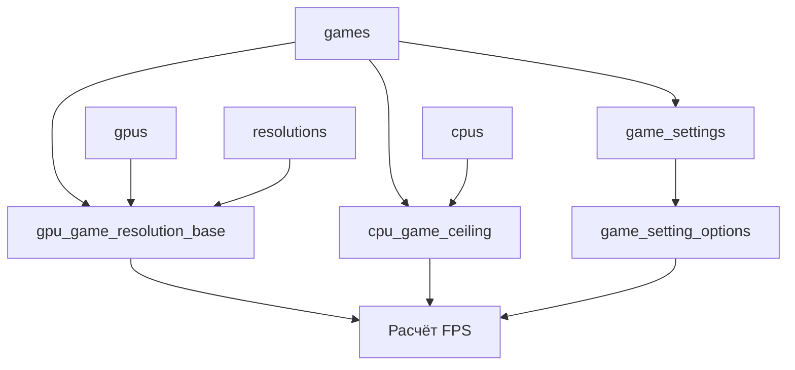

# База данных и алгоритм расчёта

## Как читать базу

`data/fps_conditions.sqlite` — готовый файл SQLite. В справочниках хранится железо и игры, в факторных таблицах — составляющие расчёта, в таблицах настроек — возможные значения и их коэффициенты. Отдельной строки для каждой комбинации CPU × GPU × игра × разрешение × все настройки нет.

Открывайте файл только для чтения. При работе через Python URI выглядит как `file:/absolute/path/fps_conditions.sqlite?mode=ro` с `uri=True`. Путь считайте относительно каталога приложения либо передавайте через настройку. Клиентские компоненты не должны открывать SQLite или получать весь файл базы.

## Основные таблицы

| Таблица | Строк | Основные поля и смысл |
| --- | ---: | --- |
| `games` | 391 | `id`, `slug`, `name`, `demand`, `category`, `fps_cap`, `cpu_heavy` |
| `cpus` | 454 | `id`, `slug`, `name`, `score`, `group_name` |
| `gpus` | 259 | `id`, `slug`, `name`, `vendor`, `vram_gb`, `is_rtx`, `supports_rt` |
| `resolutions` | 4 | `id`, `key`, `label`, `multiplier` |
| `gpu_game_resolution_base` | 405076 | `game_id`, `gpu_id`, `resolution_id`, `base_gpu_fps` |
| `cpu_game_ceiling` | 177514 | `game_id`, `cpu_id`, `cpu_ceiling_raw` |
| `game_settings` | 2017 | `id`, `game_id`, `key`, `name`, `type`, `setting_order`, `high_index`, `why` |
| `game_setting_options` | 6877 | `setting_id`, `option_index`, `label`, `multiplier` |
| `game_state_spaces` | 391 | Число состояний, основания разрядов и их шаги |
| `fps_game_availability_exclusions` | 2 | Игры, исключённые из публичного списка, причина и происхождение |
| `fps_game_hardware_requirements` | 2 | Игры, которым обязательна аппаратная поддержка RT |
| `manual_fps_cache` | 0 | Пустой необязательный кеш; он не является источником FPS |
| `meta` | 34 | Версии, source hash, счётчики и метаданные поддерживаемости |

Полная схема всех таблиц находится в `schema.sql`, поля и внешние ключи — в `data_dictionary.json`. Поля `score`, `demand` и `resolutions.multiplier` нужны для происхождения базовой модели; заново рассчитывать по ним готовые факторные таблицы в задании не требуется.

## Связи



В API используйте slug: `counter-strike-2`, `amd-ryzen-5-5600`, `nvidia-rtx-4060`. Числовые `id` нужны для JOIN внутри базы. Отображаемое название не является ключом. Нельзя подменять неизвестную модель похожей видеокартой или процессором.

Разрешения базы: `1080p` = 1920×1080; `1440p` = 2560×1440; `uw1440` = 3440×1440; `2160p` = 3840×2160. Обозначения полного сайта `1920x1080` и `3840x2160` относятся к другому уровню API. В учебном низкоуровневом API используйте ключи SQLite.

## Получение факторов

Параметры запроса привязывайте средствами драйвера. Не вставляйте введённые пользователем значения конкатенацией в SQL.

```sql
SELECT b.base_gpu_fps, c.cpu_ceiling_raw, g.fps_cap
FROM games AS g
JOIN gpus AS gpu ON gpu.slug = :gpu
JOIN cpus AS cpu ON cpu.slug = :cpu
JOIN resolutions AS r ON r.key = :resolution
JOIN gpu_game_resolution_base AS b
  ON b.game_id = g.id
 AND b.gpu_id = gpu.id
 AND b.resolution_id = r.id
JOIN cpu_game_ceiling AS c
  ON c.game_id = g.id AND c.cpu_id = cpu.id
WHERE g.slug = :game;
```

Настройки получайте через JOIN `game_settings` и `game_setting_options`. Сортировка обязательна: `setting_order`, затем `option_index`. Группируйте опции по `game_settings.id`, а не только по `key`: у Valorant ключ `detail` повторяется на позициях 2 и 7.

## Базовый расчёт по шагам

1. Проверьте формат входа и существование точных game/CPU/GPU/resolution.
2. Проверьте исключения игры и аппаратные требования. Недоступную игру не рассчитывайте.
3. Прочитайте все настройки игры и получите полный упорядоченный вектор выбранных индексов.
4. Для каждой настройки найдите ровно одну выбранную опцию и её `multiplier`.
5. Прочитайте `base_gpu_fps`, `cpu_ceiling_raw` и `fps_cap`.
6. Перемножьте коэффициенты всех выбранных опций. Не округляйте промежуточные значения.
7. Получите GPU-лимит и возьмите минимум GPU-лимита, CPU-лимита и ограничения игры.
8. Округлите итог по правилу JavaScript Math.round для неотрицательных чисел и верните результат с контекстом.

```text
M = произведение multiplier всех выбранных опций
G = base_gpu_fps × M
C = cpu_ceiling_raw
CAP = fps_cap, при NULL — бесконечность
realFps = floor(min(G, C, CAP) + 0.5)
cpuBound = C < 0.97 × G
```

Это определение алгоритма `fps-edu-basic-v1`. Проверяйте его по `samples/basic-reference.json`.

`base_gpu_fps` уже хранится для выбранного разрешения. Умножение его ещё раз на `resolutions.multiplier` — ошибка. Используйте сырые `base_gpu_fps` и `cpu_ceiling_raw`, а не соседние округлённые столбцы `base_gpu_fps_rounded` и `cpu_ceiling`.

RT и upscale, если включены в дополнительном ручном режиме, входят в то же произведение M. Второй отдельный множитель для них не нужен. В базовой формуле M меняет GPU-лимит; CPU-лимит от M не меняется. Поле `cpuBound` вычисляется по сырым компонентным лимитам, до ограничения игры.

## Значение метрик

| Поле ответа | Определение |
| --- | --- |
| `realFps` | Округлённый итоговый средний расчётный FPS |
| `gpuFps` | `floor(G + 0.5)` для объяснения GPU-лимита |
| `cpuCeiling` | `floor(C + 0.5)` для объяснения CPU-лимита |
| `beforeSettingsFps` | `floor(min(base_gpu_fps, C, CAP) + 0.5)` |
| `settingMultiplier` | Сырое произведение M |
| `cpuBound` | `C < 0.97 × G`; отдельный признак CPU-ограничения |

Готовые округлённые метрики нужны для отображения, а не для повторного вычисления `realFps`. При C=100.51 и G=120.49 итог равен 101. Python `round()` округляет половинки иначе; для неотрицательного FPS используйте `math.floor(x + 0.5)`.

Игровой cap — верхний предел, а не минимальная обещанная производительность. Если cap=60, а GPU даёт 45, итог равен 45. Не прибавляйте проценты за объём VRAM, RAM или частоту монитора: таких членов в этой формуле нет.

## Пример на реальных строках базы

Возьмём Counter-Strike 2, Ryzen 5 5600X, RTX 3060 12GB и 1080p. В базе `base_gpu_fps = 236.57142857142858`, `cpu_ceiling_raw = 390`, cap отсутствует.

При полном векторе High `[0,2,2,1,2,2,2,2,3,2,1]` произведение коэффициентов равно 1. Получаем G=236.57142857142858, C=390, итог — 237 FPS. Полный запрос и ответ для High есть в контрольном наборе.

Если не передать selected, движок выберет все нулевые индексы. Их произведение равно 1.64685321941108. Тогда G=389.59841876353556, C=390, итог — 390 FPS. Нулевой индекс часто означает облегчённую графику; поэтому пустой selected нельзя использовать как короткую запись High.

## Ручной выбор настроек

Надёжный формат входа — `selected` с ключами `@0`, `@1` и далее. Число после @ — `setting_order`, значение — `option_index`. Такой формат работает и при повторяющихся смысловых `key`.

Низкоуровневый движок при отсутствии `selected` выбирает индекс 0 каждой настройки. При частично заполненном `selected` остальные индексы тоже равны 0. Это не пресет High. Поле `high_index` — указатель для сборки пресета, а не значение по умолчанию метода calculate.

В полной реализации движка допускаются также уникальный смысловой `key`, `#номер`, строка номера, цифровая строка индекса и название опции без учёта регистра. Неоднозначный ключ отклоняется с `AMBIGUOUS_SETTING_KEY`. Обязательная учебная версия может принимать только `@номер` и целочисленный индекс, если это явно указано в README. Расширенный парсер проверяйте по отдельному эталону сайта.

## Как сформировать High и Medium

Панель должна отправлять полный вектор, а не пустой `selected`. Для каждой игры сначала обработайте настройки функций: RT Off, upscale Off или native 100%/1x, FG Off. Не выбирайте активную функцию только потому, что её опция стоит последней.

Для остальных настроек используйте этот порядок:

1. Ищите точное название требуемого качества без учёта регистра и с нормализацией пробелов: High или Medium.
2. Для High без точного имени используйте опцию с `option_index = high_index`. Если её нет, верните «Качество недоступно».
3. Для Medium без точного имени найдите позицию опции с `option_index = high_index` и возьмите предыдущую опцию. Если такой позиции нет либо она первая, используйте позицию `floor((число опций − 1) / 2)`. Ориентируйтесь именно на high_index, а не на опцию с названием High: эти значения иногда различаются.
4. Для специального `key = source-quality` принимайте только точное названное качество; отсутствующее не выдумывайте.

Это перевод общего качества в реальные опции каждой игры. High в одной игре может быть индексом 1, в другой — 2 или 3. Поля `pin`, `visual` и `impact` сами по себе не добавляют множителей: для арифметики используется коэффициент выбранной опции.

Дополнительные Low и Ultra: сначала искать Low/Ultra, для Ultra также Epic; затем Low берёт первую опцию, Ultra — Very High/Maximum или последнюю. Этот общий перевод не заменяет source-native профили из дополнительного задания.

## Проверки поддерживаемости

Показывайте игры, отсутствующие в `fps_game_availability_exclusions`. Само наличие записи в `games` не означает публичную доступность. В этом снимке исключены `days-gone-remastered` и `saros`.

Если игра есть в `fps_game_hardware_requirements`, видеокарта обязана иметь `supports_rt = 1`, даже если пользователь выключил дополнительный RT. В снимке это Indiana Jones and the Great Circle и Metro Exodus Enhanced Edition: обязательный рендерер игры нельзя отключить настройкой панели.

Прочитайте JSON из `meta` по ключу `fps_game_setting_support`. Записи с `supported=false` определяют исторические RT/upscale-контролы, которые нельзя включать. Для такой настройки допустим только индекс 0. Отразите это в ответе settings и в валидации calculate.

В обязательном режиме все отключаемые функции выключены. Если нужной Off/native-опции нет, честно сообщите, что сценарий не поддержан. Не подставляйте активную RT-опцию для явно запрошенного Off.

Для дополнительного активного RT проверяйте поддержку GPU и наличие режима игры. Генерация кадров в текущем публичном сценарии не моделируется: не добавляйте произвольный коэффициент ×2. Наличие upscale-множителя само по себе не доказывает доступность конкретной технологии DLSS, FSR или XeSS.

## stateId и большие числа

`stateId` компактно кодирует вектор опций в смешанной системе счисления. Если количество опций по порядку равно `[3, 2, 4]`, индекс первой настройки — младший разряд.

```text
stride[0] = 1
stride[i] = произведение количества опций всех предыдущих настроек
stateId = сумма selectedIndex[i] × stride[i]
stateCount = произведение количества опций всех настроек
```

Для индексов `[2, 1, 3]`: `stateId = 2 + 1×3 + 3×6 = 23`, `stateCount = 24`. Декодируйте по очереди остатком от деления на число опций, затем целочисленным делением. Допустимый диапазон: `0 <= stateId < stateCount`.

Используйте BigInt в JavaScript и передавайте большие значения в JSON десятичными строками. В учебном API `stateId` всегда строка. В существующем ручном API сайта `stateId` может возвращаться безопасным JS-числом, а `stateCount` строкой; формат конкретного эталона указан в его файле.

Если одновременно пришли `stateId` и `selected`, используйте `stateId`. Это правило входит в учебный контракт и в контрольные примеры; selected не должен перезаписать декодированный вектор.

Не перебирайте и не сохраняйте все состояния. Для одного запроса нужен один вектор и один проход по его настройкам. Огромные общие счётчики в meta — описание потенциального пространства, а не число фактически сохранённых строк.
