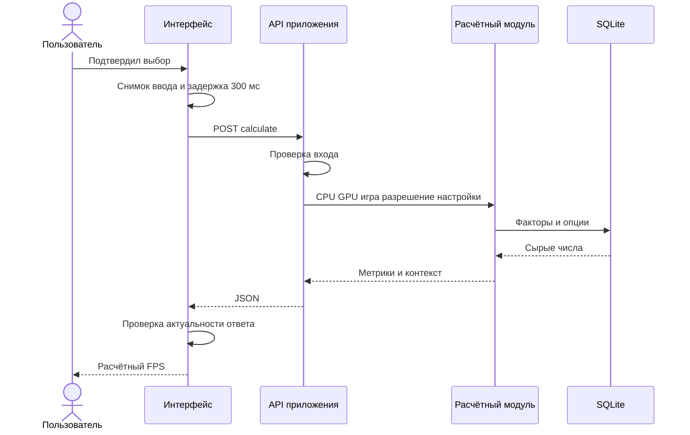

# API и проверка задания

## Разделение приложения

Браузер хранит выбор и отображает результат. Сервер принимает запрос, проверяет его и обращается к вычислительному модулю. Модуль читает SQLite через репозиторий данных и возвращает метрики. Формула не должна зависеть от React, HTTP или компонентов страницы.



Не пересылайте на сервер клиентские значения `fps`, `base_gpu_fps`, множители или CPU-лимит как доверенные входы. Они берутся из базы. Для расчёта нужен один набор точных идентификаторов и индексов.

## Учебный HTTP контракт

Эти маршруты реализуйте у себя. Префикс `/api/fps` выбран для самостоятельного приложения. На сайте аналогичное низкоуровневое семейство имеет префикс `/api/v1/configurator/fps`; обращаться к сайту для выполнения задания не требуется.

| Метод и путь | Вход | Результат |
| --- | --- | --- |
| `GET /api/fps/meta` | Нет | Алгоритм, версия набора и счётчики |
| `GET /api/fps/games` | `page`, `pageSize`, необязательный `q` | Доступные игры, total и признак следующей страницы |
| `GET /api/fps/cpus` | Те же параметры | Процессоры из базы |
| `GET /api/fps/gpus` | Те же параметры | Видеокарты с vendor, VRAM и поддержкой RT |
| `GET /api/fps/resolutions` | Нет | Четыре разрешения базы |
| `GET /api/fps/games/:slug/settings` | Точный slug игры | Настройки и их опции, порядок, highIndex, поддерживаемость, stateCount |
| `POST /api/fps/calculate` | CPU, GPU, игра, разрешение, selected либо stateId | Метрики одного расчёта и контекст |

Для справочников используйте стабильную сортировку, например по `name`, затем `slug`. `page` начинается с 1, `pageSize` — от 1 до 100. В `items` возвращайте только запрошенную страницу. Поля пагинации: `page`, `pageSize`, `totalItems`, `totalPages`, `hasNextPage`, `hasPreviousPage`. Поиск `q` не запускает расчёт FPS.

Для чтения settings верните массив, где у каждой настройки есть `order`, `key`, `name`, `type`, `highIndex`, `why`, `options`. У опции — `index`, `label`, `multiplier`. Если метаданные запрещают настройку, добавьте `supported: false`. Повторяющиеся смысловые ключи перечислите в `duplicateKeys`.

## Формат запроса расчёта

Пример полного вектора High для Counter-Strike 2, RT отсутствует, FSR выключен:

```json
{
  "cpu": "amd-ryzen-5-5600",
  "gpu": "nvidia-rtx-4060",
  "game": "counter-strike-2",
  "resolution": "1080p",
  "selected": {
    "@0": 0,
    "@1": 2,
    "@2": 2,
    "@3": 1,
    "@4": 2,
    "@5": 2,
    "@6": 2,
    "@7": 2,
    "@8": 3,
    "@9": 2,
    "@10": 1
  }
}
```

Для обязательной версии `cpu`, `gpu`, `game`, `resolution` — непустые строки с точными ключами базы. `selected` необязателен; при его отсутствии все индексы равны 0. Поддержите ключи `@номер` и целочисленные индексы. При переданном `stateId` используйте его для декодирования и не применяйте `selected` повторно. `stateId` передавайте десятичной строкой.

## Формат успешного ответа

HTTP 200. Верните `algorithm: fps-edu-basic-v1`, `datasetSourceHash`, исходные `cpu`, `gpu`, `game`, `resolution`, `metrics`, `stateId` строкой и `selectedSettingIndexes` в порядке настроек. Названия компонентов можно добавить отдельными полями для UI.

Поля `metrics`: `realFps`, `gpuFps`, `cpuCeiling`, `beforeSettingsFps`, `settingMultiplier`, `cpuBound`. Для объяснения ограничения добавьте `gameCapFps: number | null`, прочитанный из games.fps_cap. Формулы приведены в предыдущем документе. В контрольных примерах поле `expected` содержит обязательную числовую часть; дополнительные метаданные интерфейса не влияют на проверку арифметики.

Результат относится к одному алгоритму и одной версии базы. `datasetSourceHash` — значение `meta.source_hash`. SHA256 всего файла базы — отдельная проверка целостности; он не обязан совпадать с `source_hash`.

## Ошибки

Формат учебной ошибки: JSON с `error.code` и понятным `error.message`. Числовое поле `fps` в ошибке отсутствует. Выберите и документируйте свои точные коды для учебного API; ниже обязательные смысловые группы.

| HTTP статус | Ситуация | Реакция UI |
| --- | --- | --- |
| 400 | Неверный тип, индекс вне диапазона, неизвестная настройка, stateId вне диапазона | Пояснение у ввода, результат не показывается |
| 404 | Не найден CPU/GPU/game/resolution либо игра исключена | unavailable, «Выбор недоступен», предложить выбрать заново |
| 422 | Сценарий несовместим с GPU или функция не поддержана | «Нет оценки для этих параметров» с причиной |
| 500 | Нарушена целостность базы либо отсутствуют обязательные факторы | Общая ошибка и повтор; подробности в серверном логе |

Ошибки существующего API сайта зафиксированы отдельно в `site-manual-reference.json`. Их точные коды нужны для дополнительной совместимости, а не для арифметической проверки базовой модели.

Проверяйте границы на сервере, даже если UI ограничивает выбор. Поля неизвестного назначения отклоняйте. Ограничьте длину строк и размер объекта selected. Не возвращайте пользователю stack trace и SQL-текст с внутренними деталями.

## Как проверять числа

В `samples/basic-reference.json` каждый case содержит `request` и `expected`. Вызовите свою вычислительную функцию либо свой endpoint с этим request. Сравните целочисленные метрики и индексный вектор точно; `settingMultiplier` и сырые float сравнивайте с небольшой относительной погрешностью, например `1e-9 × max(1, abs(expected))`.

Все случаи базового набора должны пройти. Не исправляйте эталон под свой ответ. Если не совпадает, проверьте полный вектор, порядок опций, повторный множитель разрешения, промежуточное округление и случайное применение калибровок.

`site-manual-reference.json` содержит отдельные успешные ответы и ошибки существующего `calculateFps`. Это не ответы панели полного конфигуратора и не ответы source-native сценариев. Такой набор проверяет дополнительную калиброванную реализацию ручного API.

## Сценарии приёмки интерфейса

| Проверка | Как воспроизвести | Ожидаемое поведение |
| --- | --- | --- |
| Hover | Открыть Network и водить указателем по играм/качествам | Ноль FPS-запросов; значения не меняются |
| Черновик | Отметить игры и закрыть библиотеку без применения | Подтверждённый список прежний |
| Применение | Отметить игры и нажать «Применить» | Новые строки и расчёты только после применения |
| Неполный ввод | Оставить CPU или GPU пустым | Понятная подсказка; нет calculate-запроса |
| Два качества | Открыть сравнение игры | Два независимых результата для одного разрешения |
| Отмена сравнения | Изменить разрешение в окне и отменить | Общая панель не меняется |
| Применение сравнения | Выбрать готовое качество и применить ко всем | Общие настройки и результаты обновляются |
| Debounce | Быстро переключить параметры несколько раз | Предыдущие таймеры сняты, итог соответствует последнему вводу |
| Гонка | Задержать ответ A, отправить B, затем разрешить A | A не перезаписывает B |
| Ошибка одной игры | Подменить один ответ ошибкой | Другие игры продолжают показывать свои результаты |
| Неизвестная модель | Отправить несуществующий slug напрямую | Ошибка; похожая модель не подставляется |
| Недоступная игра | Прямой запрос исключённой игры | 404, «Выбор недоступен», без фиктивных 0 FPS |
| Неподдержанный сценарий | Невозможный режим или несовместимая GPU | 422, «Нет оценки» с причиной |
| Повреждение факторов | В тестовой копии убрать обязательный фактор | 500 и error, без числового результата |
| CPU-ограничение | Увеличить GPU-лимит при прежнем меньшем CPU-лимите | FPS остаётся около предела CPU |
| Cap | Пример Elden Ring из эталонов | Значение не превышает 60 при более быстрых компонентах |
| Дублирующийся ключ | Valorant detail на позициях 2 и 7 | Две независимые настройки через @2 и @7 |
| Разрешение | Выбрать 1440p вместо 1080p | Другой base row, без повторного resolution.multiplier |
| Повтор | Выключить API, получить ошибку, включить и повторить | Новый запрос и успешное восстановление |
| Клавиатура | Пройти выбор без мыши | Выбор, применение, отмена и подсказки доступны |
| Телефон | Открыть узкий экран | Все действия работают касанием, hover не обязателен |

Для гонок используйте управляемые задержки или тестовый fetch. Не замедляйте реальную базу тяжёлыми запросами. Проверки не требуют подключения к магазинам, оплате или сторонним сервисам.

## Порядок выполнения

1. Проверить комплект и изучить связи на трёх SQL-запросах.
2. Написать модуль чтения SQLite и чистую вычислительную функцию. Пройти числовые примеры.
3. Сделать справочники и calculate API. Проверить невалидный ввод и отсутствие моделей.
4. Сделать выбор CPU/GPU и одну игру с отображением готового ответа.
5. Добавить библиотеку игр с черновиком и общие настройки.
6. Добавить сравнение High/Medium и применение ко всем.
7. Добавить состояния загрузки, отмену, защиту от старых ответов и повтор.
8. Проверить клавиатуру, телефон и сценарии приёмки. После этого брать расширения.

## Что сдать преподавателю

Сдайте исходники, собственный README с точными командами запуска, имя алгоритма, инструкцию запуска проверок и результаты контрольных случаев. Приложение должно запускаться на своей копии SQLite без переменных и сервисов UCOMS.

Покажите на защите три вещи: как запрос проходит от клика до SQL, почему при сильной GPU FPS может ограничиться CPU и как поздний ответ не перезаписывает новый выбор. Объясните отличие базового фактора, результата по настройкам и исторической калибровки.

Дополнительные задания: ручной редактор настроек, stateId-ссылка на сценарий, локальное сохранение выбора с проверкой актуальности slug, кеш, Low/Ultra, Ultrawide и калиброванный режим. Они не должны ломать обязательный базовый режим.
